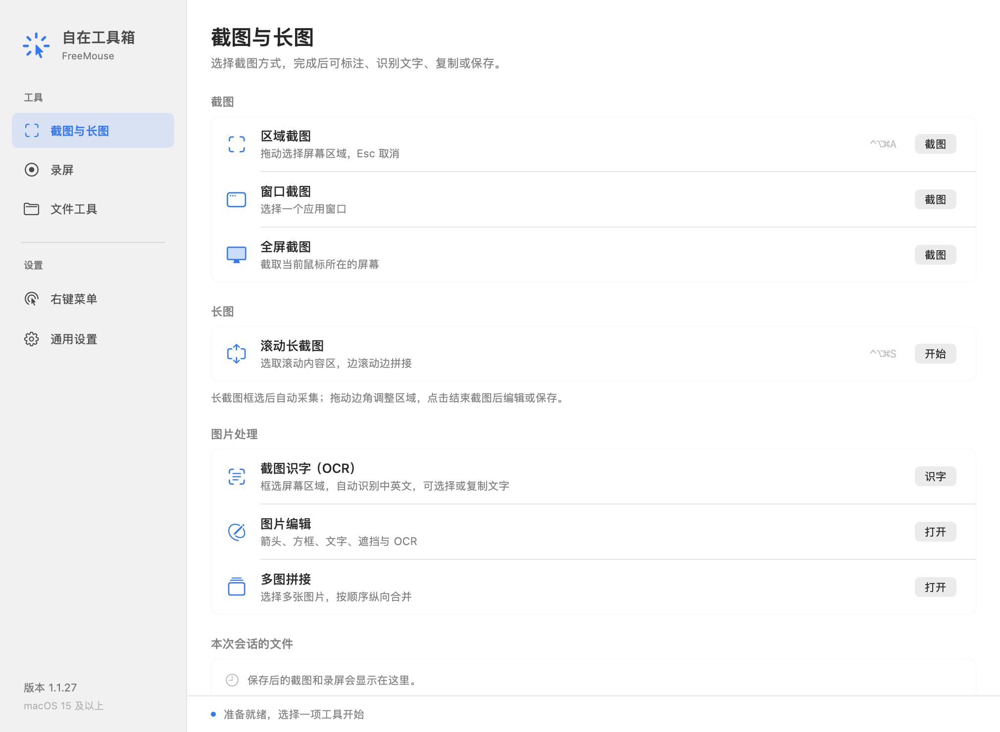
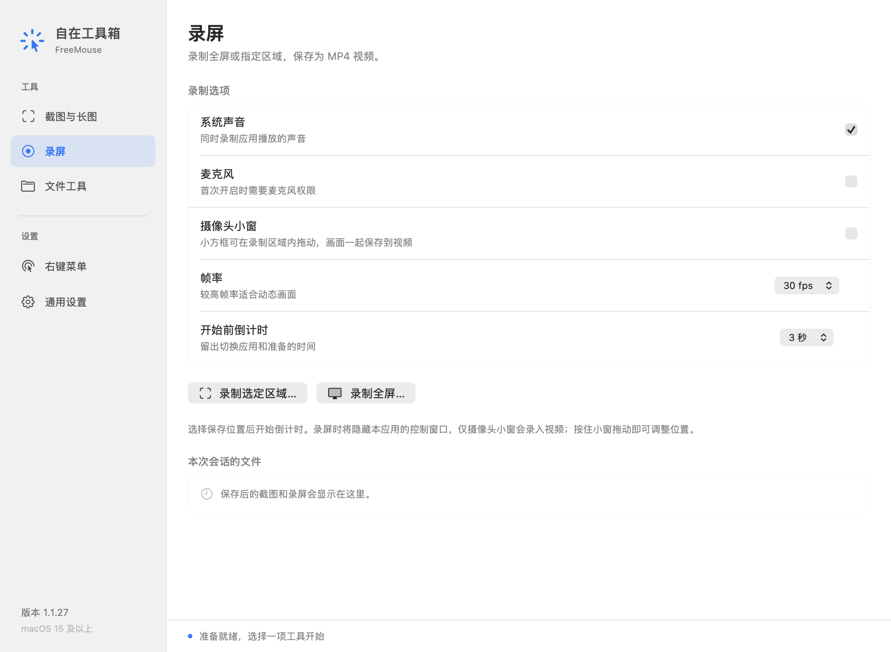
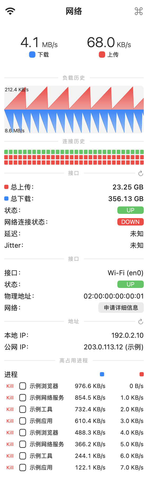

# 自在工具箱 FreeMouse

一个常驻 macOS 菜单栏的工具箱，集成截图 / OCR、滚动长截图、录屏、网络监控和 Finder 文件工具。

**当前版本：1.1.29 · Apple Silicon · macOS 15+**

## 主要功能

| 功能 | 支持内容 |
| --- | --- |
| 截图与 OCR | 区域、全屏、窗口截图；本机中英文识别；复制文字 |
| 长截图与图片编辑 | 滚动拼接、矩形 / 箭头 / 画笔 / 文字 / 遮挡、贴图、多图拼接 |
| 录屏 | 全屏或区域、系统声音、麦克风、摄像头小窗、30 / 60 fps、MP4 |
| 网络监控 | 菜单栏实时网速、历史图表、接口 / IP、延迟与抖动、进程流量排行及 Kill |
| 文件与右键菜单 | 新建模板、剪切 / 移动 / 复制、批量重命名、路径复制、哈希、图片转换；菜单显隐与排序 |
| 框选翻译 | 点击菜单栏翻译图标，拖框选字后自动 OCR + macOS 系统翻译；支持朗读、复制、置顶 |
| 个性设置 | 自定义全局快捷键、菜单栏图标间距和网速右侧留白 |

## 界面预览

### 截图、长图与 OCR



<details>
<summary>查看录屏设置</summary>



</details>

<details>
<summary>查看网络监控与进程管理</summary>



网络图中的流量、地址和进程均为演示数据，不代表实测网速。所有图片来自软件自身界面的离屏渲染，未截取私人桌面。

</details>

点击菜单栏独立翻译图标后拖动选择文字区域，松开鼠标自动识别并翻译；Esc 取消。译文面板可更换语言、重新框选、朗读和复制。

框选翻译及各菜单工具的全局快捷键可在「通用设置 → 快捷键」中录入、清除或恢复默认，修改后立即生效。新增功能默认不占用快捷键。

## 安装与使用

1. 打开 Apple Silicon 版 DMG，将「自在工具箱.app」拖入「应用程序」。升级前先退出旧版。
2. 启动后常驻菜单栏：**点击图标**打开工具菜单，**点击网速**打开网络面板。
3. 从「打开自在工具箱」进入各功能；在「通用设置」调整快捷键、间距及权限。

当前安装包使用本地 ad-hoc 签名，未经 Apple 公证。若系统阻止打开，可先尝试启动一次，再到「系统设置 → 隐私与安全性」选择「仍要打开」。

截图和录屏需要屏幕录制权限；麦克风、摄像头、独立鼠标菜单和 Wi-Fi 详情按需申请相应权限。Finder 扩展可在系统扩展设置中启用。

长截图请只框选滚动正文，缓慢向下滚动，完成后点击「结束截图」。动画、固定遮挡或过快滚动可能影响拼接。**Kill 会直接强制结束进程，可能丢失未保存内容**；权限不足时不会自动提权。

## 默认快捷键

| 功能 | 快捷键 |
| --- | --- |
| 区域截图 | ⌃⌥⌘A |
| 滚动长截图 | ⌃⌥⌘S |
| 开始 / 停止区域录屏 | ⌃⌥⌘R |

OCR、全屏和窗口截图默认未绑定，可在「通用设置 → 快捷键」配置。菜单栏内部间距可调 0–20 点，右侧留白可调 0–12 点。

## 数据与隐私

截图、OCR、图片处理和录屏在本机完成。网络详情面板展开时会查询公网 IP 并检测 HTTPS 连通性，关闭后停止外部探测和进程读取；菜单栏网速采样仍在本机继续。系统翻译使用 Apple Translation 框架，首次使用可能需要下载语言包。原有网页翻译会将主动选中的文字发送到 Google 或百度。

## 从源码构建

安装 macOS Command Line Tools 后，在项目目录运行：

```bash
python3 scripts/build.py
```

应用生成于 `.build/release-1.1.29/自在工具箱.app`。构建目录已存在时，使用 `python3 scripts/build.py --refresh-binary` 更新可执行文件。

版本变化见[历史记录](docs/CHANGELOG.md)，测试范围和已知失败见[验证记录](docs/VALIDATION-1.1.29.md)。

## 开源许可

FreeMouse 自有代码使用 [MIT](LICENSE)；网络功能复用 [Stats](https://github.com/exelban/stats) 的 MIT 代码，长截图集成 [Capso](https://github.com/lzhgus/Capso) 的 BSL 1.1 代码。第三方完整条款、固定版本和适配说明见[第三方声明](THIRD_PARTY_NOTICES.md)。
