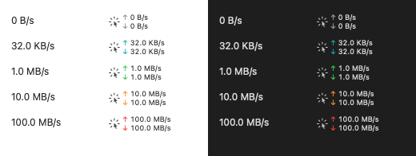
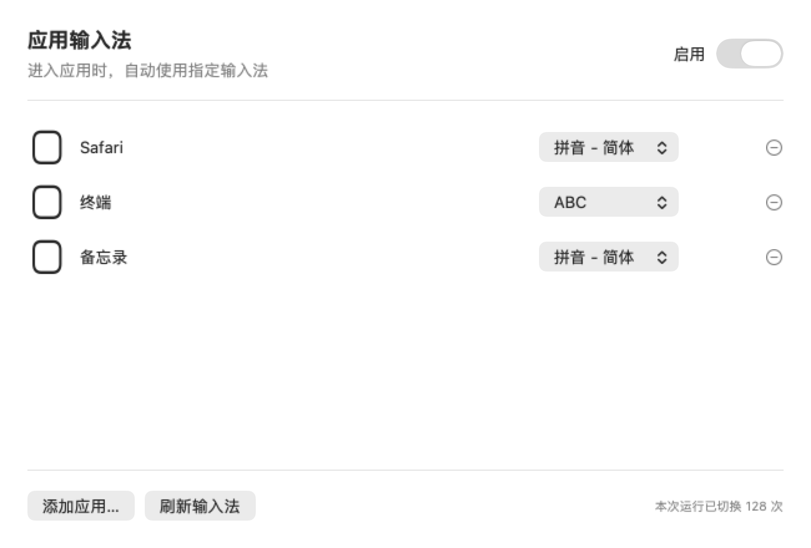
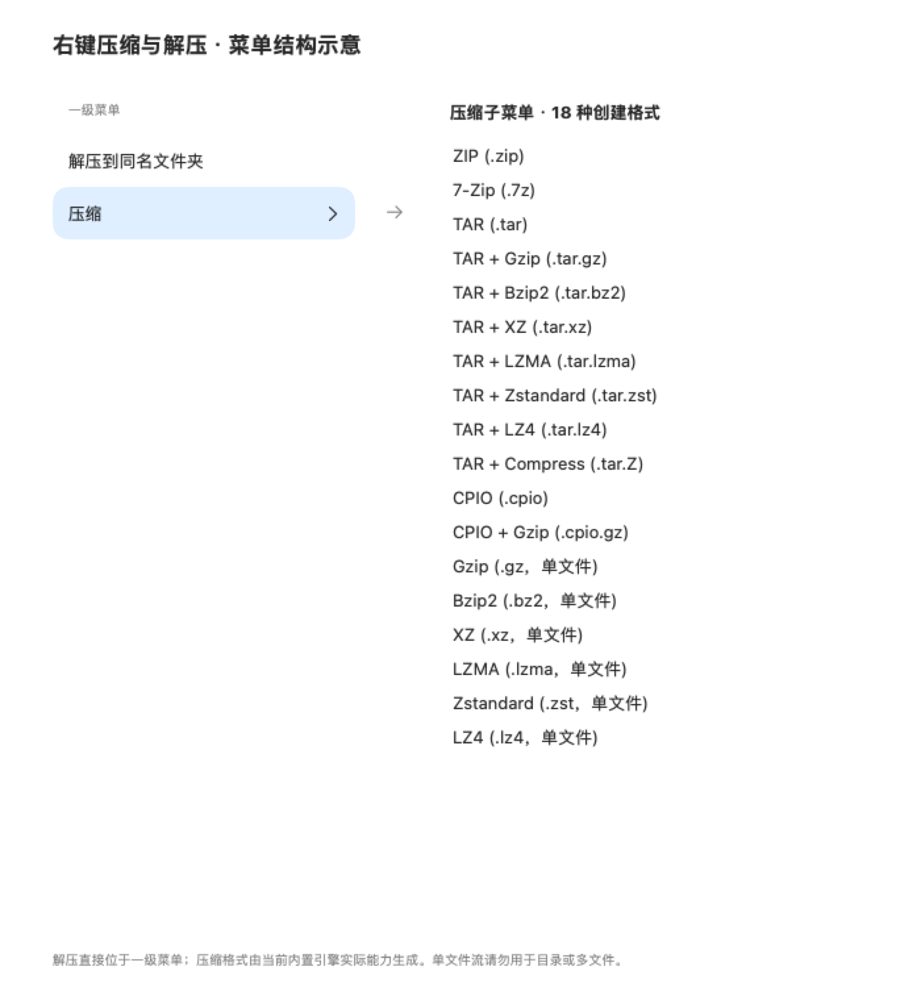

# OmniDesk

常驻 macOS 菜单栏的工具箱：截图、OCR 与翻译，录屏和网络监控，应用与启动项管理，以及 Finder 文件操作。

**1.1.38 · Apple Silicon · macOS 15+**

## 安装与快速上手

1. 使用已取得的 DMG 安装包，将「OmniDesk.app」拖入「应用程序」；升级前先退出旧版。当前源码版本为 **1.1.38**，下载预编译包时请核对其版本号，也可按下方说明自行构建。
2. 启动后，菜单栏有三个点击区域：**工具箱图标**打开功能菜单，**网速区域**打开网络详情，独立的**翻译图标**开始框选翻译。
3. 在「通用与右键设置」中配置快捷键、菜单显隐与排序、菜单栏间距和网速右侧留白。Finder 扩展需在系统扩展设置中启用。

本地安装包使用 ad-hoc 签名，未经 Apple 公证。若 macOS 阻止打开，可先尝试启动一次，再到「系统设置 → 隐私与安全性」选择「仍要打开」。

## 可以用它做什么

| 需要做的事 | 从哪里开始 |
| --- | --- |
| 截图、识别文字、标注或拼接长图 | 工具箱 → 区域 / 窗口 / 全屏截图、长截图，或打开图片 |
| 翻译屏幕上的文字 | 点击菜单栏翻译图标，拖框选择文字 |
| 录制操作过程 | 工具箱 → 区域 / 全屏录屏；可选择系统声音、麦克风和摄像头小窗 |
| 查网速、网络延迟和占网进程 | 点击菜单栏网速区域 |
| 管理正在运行的软件和登录启动 | 工具箱 → 应用与启动项管理 |
| 查看风扇转速、临时使用硬件最大转速 | 工具箱 → 风扇控制 |
| 切到不同软件时自动选择输入法 | 工具箱 → 应用输入法 |
| 新建、移动、重命名、压缩或解压文件 | Finder 中选中文件后右键；菜单内容可自定义 |

## 截图、长图与 OCR

区域、窗口和全屏截图后可直接标注：矩形、箭头、画笔、文字、遮挡、贴图及多图拼接；中英文 OCR 在本机完成，可复制识别文字。Finder 图片右键也能进入编辑器。

长截图先框选**滚动正文**，缓慢向下滚动，完成后点击「结束截图」。动画、固定遮挡和过快滚动可能影响拼接，尽量避开工具栏与悬浮控件。


## 框选翻译

点击菜单栏翻译图标，拖框选字，松开后自动识别并调用 macOS 系统翻译；Esc 取消。面板支持语言切换、朗读、复制、置顶、取消和重新框选。重复内容使用当前进程内缓存，macOS 26.4+ 优先使用系统低延迟模型；首次使用可能需要下载语言包。


## 录屏与摄像头

在工具箱选择区域或全屏录屏，按需打开系统声音、麦克风和摄像头小窗；支持 30 / 60 fps，输出 MP4。再次触发区域录屏快捷键可停止录制，录制中也可从工具箱菜单停止。


## 网络监控

菜单栏持续显示上传与下载速率。**只有上传、下载箭头分别随速度渐变，数字和单位保持单色**，便于快速辨认方向和读数。



点击网速查看流量历史、接口与 IP、延迟和抖动、进程流量排行。进程旁的 **Kill 会强制结束进程，可能丢失未保存内容**；权限不足时不会自动提权。


## 应用与启动项管理

用「全部 / 运行中 / 未运行 / 已开登录启动」筛选并搜索软件，查看图标、版本、PID 和实时运行状态。每行可启动、显示到前台或普通退出；「更多」提供隐藏、取消隐藏、重启、强制退出、在 Finder 中显示和复制路径。

勾选当前列表中的应用后可**批量启动或普通退出**，隐藏在筛选结果外的选择不会被批量操作。普通退出可能等待保存提示，不会自动升级为强退；重启需等待旧实例退出。强制退出逐项确认，并核验确认时的进程身份，避免误操作后来重启的新实例。

「标准登录项」开关直接设置系统登录项；「后台启动服务」列出 LaunchAgent / LaunchDaemon、应用内嵌配置和登录辅助程序，并关联所属应用。可管理的服务支持直接开关，修改影响以后登录或加载，不会立即启动或终止现有服务。

首次读取登录项需允许 OmniDesk 控制 **System Events**，系统后台服务修改按需请求管理员认证。标准登录项不等于所有自启动机制：Apple 保护项和无法通过公共接口管理的 SMAppService 项目会标为只读；仅发现内嵌配置不代表已经注册，未知状态不会显示成关闭。


## 风扇控制

打开面板查看实际 RPM，选择「系统自动」或「硬件最大转速」。最大转速使用风扇报告的硬件上限，系统按需请求管理员授权，不安装常驻守护服务；面板根据实际转速显示正在升速或接近上限。

25 秒内未达到预期会报错并恢复自动；退出应用、控制连接中断或超时后也恢复系统自动。**本版在 Mac17,2 实测约 6550 RPM 并成功恢复自动**，其他机型取决于固件支持，不能保证同样可控。请避免同时使用其他风扇控制软件。


## 按应用切换输入法

添加应用，为它选择系统中已启用的输入法，再打开「启用」。之后切换到该应用时自动应用规则；支持暂停和切换计数。未配置的应用保持当前输入法，缺失的输入法会提示重新选择。功能默认暂停，不需要辅助功能权限。



## Finder 文件工具与压缩解压

右键可新建模板文件或文件夹、剪切与移动、批量重命名、复制路径和文件名、计算哈希、转换图片格式，以及在终端打开目录。可在设置中隐藏不常用项目、调整菜单顺序。

解压直接选择一级菜单「解压到同名文件夹」；创建压缩包在「压缩」子菜单选择格式。输出放在原位置，同名自动编号，不覆盖已有文件。内置 7-Zip、Zstandard 和 LZ4，无需安装 Homebrew。

| 场景 | 支持范围 |
| --- | --- |
| 创建归档 | ZIP、7z、TAR、tar.gz、tar.bz2、tar.xz、tar.lzma、tar.zst、tar.lz4、tar.Z、CPIO、cpio.gz |
| 创建单文件压缩流 | gz、bz2、xz、lzma、zst、lz4；与上行合计 **18 种创建格式**，目录或多选请用归档格式 |
| 解压与读取 | 常用 ZIP / ZIPX、7z、RAR / RAR5、TAR 系列，以及 CAB、ARJ、XAR / PKG、DMG、DEB、RPM、ISO 等；具体变种受引擎支持限制 |
| 加密和分卷 | 已验证加密 ZIP / 7z 及 `.7z.001`；从首卷开始，其他变种取决于引擎；不提供 RAR 创建 |

密码只用于当次解压，通过标准输入传递，不保存也不放入进程参数。压缩会排除常见 macOS 元数据，保留普通隐藏文件；解压检查越界路径、循环链接与特殊文件，单次限制 20 GiB、100000 项，详细范围见验证记录。



以上图片均直接展开，便于浏览。应用管理、输入法、风扇和翻译面板使用示例数据演示，转速、PID、启动状态和翻译文本不代表本机实时状态；压缩解压图为根据实际菜单配置生成的结构示意。截图生成方法见[界面图说明](scripts/readme-screenshots/README.md)。

## 快捷键

| 功能 | 默认组合 |
| --- | --- |
| 区域截图 | ⌃⌥⌘A |
| 滚动长截图 | ⌃⌥⌘S |
| 开始 / 停止区域录屏 | ⌃⌥⌘R |

其余工具默认未绑定，可在「通用与右键设置 → 快捷键」中录入、清除或恢复默认；应用管理、风扇和应用输入法均可绑定。更改立即生效，并检查组合冲突。

## 权限与隐私

截图、框选翻译和录屏需要屏幕录制权限；麦克风、摄像头、独立鼠标菜单及 Wi-Fi 详情按需申请权限。系统登录项的自动化授权、后台服务和风扇的管理员认证只在相关操作时请求。

截图、OCR、图片处理、录屏和菜单栏网速采样在本机完成。系统翻译使用 Apple Translation 框架，译文缓存只保留在当前进程。网络详情展开时查询公网 IP、检测 HTTPS 连通性并读取进程流量，关闭后停止这些操作；主动使用 Google / 百度网页翻译时，提交的文字会发送到对应网站。

## 从源码构建

安装 macOS Command Line Tools 后，在项目目录运行：

```bash
python3 scripts/build.py
```

生成 `.build/release-1.1.38/OmniDesk.app`。构建目录已存在时，用 `python3 scripts/build.py --refresh-binary` 更新可执行文件。

[历史版本](docs/CHANGELOG.md) · [验证记录与已知问题](docs/VALIDATION-1.1.38.md)

## 开源许可

自有代码采用 [MIT](LICENSE)。网络功能复用 [Stats](https://github.com/exelban/stats) 的 MIT 代码，长截图集成 [Capso](https://github.com/lzhgus/Capso) 的 BSL 1.1 代码；完整条款见[第三方声明](THIRD_PARTY_NOTICES.md)。
